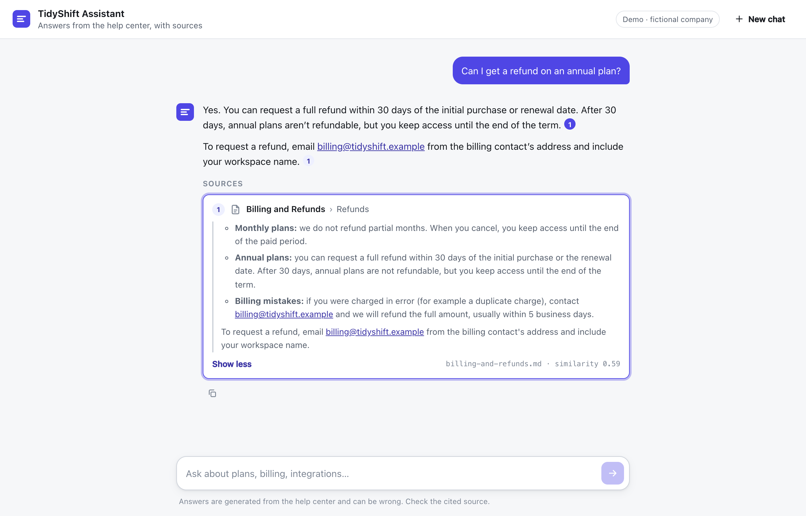
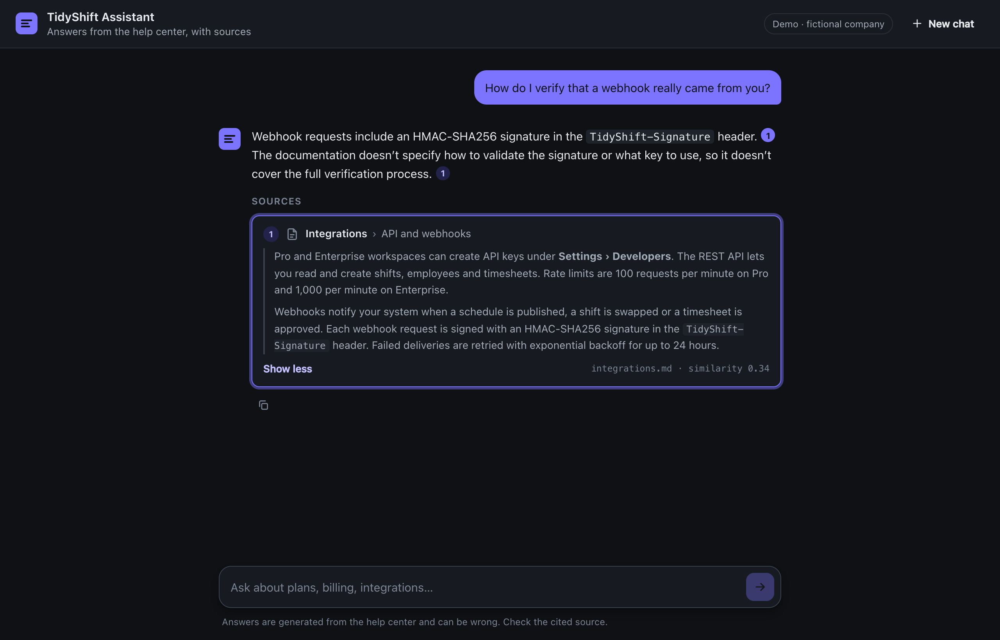
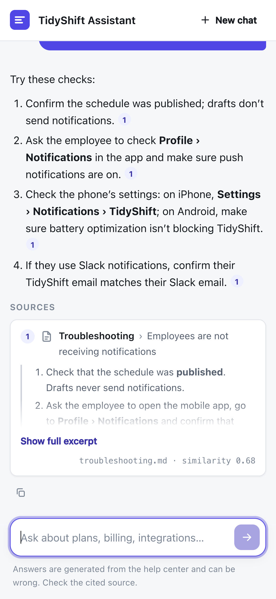
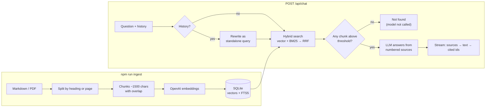

# Docs Chatbot: cited answers from your documentation

[](https://github.com/Zela0912/rag-docs-chatbot/actions/workflows/ci.yml)   [](LICENSE)

An AI support assistant that answers customer questions **only from your own documentation**, links every claim to the exact passage it came from, and says _"I couldn't find this"_ instead of guessing.

Built with Node.js, React, TypeScript and the OpenAI API. Runs as a single process with SQLite and needs no vector database or other extra infrastructure.



> **Demo data:** _TidyShift_ is a fictional shift-scheduling SaaS. Its help center lives in [`data/docs`](data/docs). Drop in your own Markdown or PDF files and run `npm run ingest`.

## Why this exists

Support teams answer the same questions every day, and the answers are already in the help center. A generic chatbot doesn't help, because it invents answers that sound right. This one is built for the questions a business owner asks first:

| Question                                           | How it's handled                                                                                                                                               |
| -------------------------------------------------- | -------------------------------------------------------------------------------------------------------------------------------------------------------------- |
| _Will it make things up?_                          | Answers use only retrieved passages. When nothing relevant is found, the model is **never called** and the user gets a "not found" reply.                      |
| _Can I check where an answer came from?_           | Every statement carries a `[1]` citation. Clicking it opens the exact passage, with document, section and similarity score.                                    |
| _What does it cost to run?_                        | About **$0.09 per 1,000 answered questions** with the current models (measured, see [Evaluation](#evaluation)). Off-topic questions cost a fraction of a cent. |
| _How do we know it works?_                         | A 45-question evaluation suite measures retrieval and answer quality. Every change to the prompt or the retrieval is measured against it.                      |
| _What if someone puts instructions in a document?_ | Sources are passed to the model as data, never as instructions. The UI renders Markdown without raw HTML.                                                      |

## Features

- **Grounded answers with citations.** Answers stream in token by token. Citation badges link to source cards that show the passage itself.
- **Hybrid retrieval.** Semantic vector search and BM25 keyword search (SQLite FTS5) are fused with Reciprocal Rank Fusion. Vectors understand meaning (_"money back"_ finds _refunds_). Keywords catch exact terms the embeddings blur (_"free trial"_, plan names, error codes).
- **Follow-up questions.** With conversation history, a short model call rewrites _"and on a monthly plan?"_ into a standalone search query. If that call fails, a heuristic takes over.
- **Calibrated relevance gate.** A similarity threshold was tuned on real questions: off-topic questions score ≤ 0.18 and on-topic ones ≥ 0.36, and the threshold sits at 0.3.
- **Incremental ingestion.** Markdown is split by headings, so citations name sections. PDFs are split by page, so citations name page numbers. Files that haven't changed are skipped, so re-ingesting is free. Changing the embedding model re-embeds everything.
- **Multilingual.** Users can ask in any language and get answers in the same language. Keyword search ignores diacritics, so _"kosta"_ matches _"košta"_.
- **Production details.**
  - Rate limiting and security headers (Helmet).
  - Input validation (Zod).
  - The server stops generating when the client disconnects.
  - Structured JSON logs with token counts and latency. Question text is never logged.
  - Graceful shutdown.
  - OpenAI storage is disabled (`store: false`).
- **Accessible, responsive UI.**
  - Keyboard support and screen-reader labels.
  - Light and dark themes.
  - Mobile layout.
  - Respects reduced-motion settings.
  - Stop and retry buttons.

<p>
  
  
</p>

## How it works



1. **Ingest.** Each document is split into sections: Markdown by heading path (_Plans › Annual billing_), PDF by page. Long sections become ~1,500-character chunks with a 200-character overlap. Every chunk is embedded **together with its document title and section name**, so a short chunk like _"It costs $4 per user"_ still matches _"How much is Starter?"_.
2. **Retrieve.** The question is embedded and compared with every chunk (brute-force cosine, a few milliseconds for thousands of chunks). A BM25 keyword search runs at the same time, and the two rankings are fused.
3. **Gate.** Chunks below `MIN_SCORE` are dropped. If none are left, the user gets a fixed "not found" answer, with no model call and no cost.
4. **Answer.** The model gets the surviving chunks as numbered `<source>` blocks and strict rules: answer only from the sources, cite every claim, say what the sources don't cover, and treat source text as data.
5. **Stream.** The server sends `sources` first, then text `delta`s, then `done` with the ids that were actually cited. The client renders citations as links only when they point to a real source.

## Evaluation

`npm run eval` scores retrieval only (embeddings only, practically free). `npm run eval -- --e2e` runs the full pipeline with the chat model. Both write [`data/eval/report.md`](data/eval/report.md).

Results on the demo docs (`text-embedding-3-small` + `gpt-6-luna`, Nov 2026):

| Metric                                 | Result                                         |
| -------------------------------------- | ---------------------------------------------- |
| Answers citing a correct source        | **36/36 (100%)**                               |
| Correct source in top 5 retrieved      | **36/36 (100%)**                               |
| Correct source ranked #1               | 32/36 (89%)                                    |
| Follow-up questions resolved correctly | 5/5 (100%)                                     |
| Off-topic questions refused            | 6/6 (100%), all without calling the chat model |
| Answerable questions wrongly refused   | 0/36 (0%)                                      |
| Average tokens per answered question   | 539 in / 65 out                                |

The suite has 45 questions: paraphrases, Croatian and German questions, multi-turn follow-ups, prompt-injection attempts, and questions the docs only partially cover. The partially covered answers are listed in the report for human review.

What the evaluation changed during development:

- **Hybrid search.** The vector-only baseline missed one question (_"How long is the free trial?"_). Adding BM25 at a 0.3 weight raised top-5 recall from 97% to 100% and kept rank-1 accuracy the same.
- **Query rewriting.** A browser test found that a follow-up asked right after an off-topic question retrieved the wrong section. Rewriting follow-ups with the model fixed it, and that case is now a regression test in the suite.

## Quick start

Requires **Node.js 24+** (uses the built-in TypeScript type stripping and `node:sqlite`) and an OpenAI API key.

```bash
git clone <this repo> && cd docs-chatbot
npm install
cp .env.example .env        # add OPENAI_API_KEY
npm run ingest              # index data/docs (≈ $0.0001)
npm run dev                 # API on :3001, web on http://localhost:5173
```

Production is a single process that serves the API and the built web app:

```bash
npm run build && npm start  # http://localhost:3001
```

### Useful scripts

| Command                        | What it does                                                                  |
| ------------------------------ | ----------------------------------------------------------------------------- |
| `npm run ingest`               | Index new and changed files in `data/docs`; remove deleted ones               |
| `npm run search -- "question"` | Show what retrieval returns (scores, sections) without calling the chat model |
| `npm run eval [-- --e2e]`      | Run the evaluation suite and write `data/eval/report.md`                      |
| `npm test`                     | 76 unit and integration tests (server and UI), offline, with fake models      |
| `npm run check`                | Lint, typecheck, test and build. This is what CI runs.                        |

### Configuration

All settings are environment variables, validated at startup (see [`.env.example`](.env.example)).

| Variable                | Default                  | Notes                                                         |
| ----------------------- | ------------------------ | ------------------------------------------------------------- |
| `OPENAI_API_KEY`        | (none)                   | Required                                                      |
| `CHAT_MODEL`            | `gpt-6-luna`             | Any Responses API model                                       |
| `EMBEDDING_MODEL`       | `text-embedding-3-small` | Changing it re-embeds all documents on the next ingest        |
| `TOP_K`                 | `5`                      | Chunks sent to the model per question                         |
| `MIN_SCORE`             | `0.3`                    | Relevance gate (cosine similarity)                            |
| `HYBRID_SEARCH`         | `true`                   | `false` for vector-only (useful for comparison)               |
| `MAX_OUTPUT_TOKENS`     | `1000`                   | Hard cap on answer length and cost                            |
| `RATE_LIMIT_PER_MINUTE` | `20`                     | Per IP, on `/api/chat`                                        |
| `TRUST_PROXY`           | `0`                      | Set to `1` behind one reverse proxy (Render, Fly.io, Railway) |

## Project structure

```
shared/chat-protocol.ts    Types for the SSE protocol, imported by both server and web
server/
  src/ingest/              loaders (Markdown, PDF) → chunker → incremental pipeline
  src/llm/                 provider interfaces + the OpenAI implementation
  src/store.ts             SQLite: documents, chunks, vectors, FTS5 keyword index
  src/retrieve.ts          cosine search, BM25 fusion (RRF)
  src/prompt.ts            system prompt, source formatting, citation parsing
  src/chat/service.ts      one request: rewrite → retrieve → gate → answer
  src/routes/chat.ts       HTTP + Server-Sent Events, logging
  scripts/                 ingest, eval, search
  test/                    Vitest, with fake embedder and model (no network)
web/
  src/api/                 fetch-based SSE client and parser
  src/hooks/useChat.ts     chat state and streaming lifecycle
  src/components/          answer, citations, source cards, composer
data/
  docs/                    the knowledge base (demo: TidyShift)
  eval/                    questions.json and the generated report
```

## Design decisions

- **SQLite and in-memory search instead of a vector database.** Brute-force search over a few thousand chunks takes milliseconds, and there is nothing extra to host. All storage sits behind one class (`Store`). Moving to Postgres + pgvector for large document sets means replacing that class, and nothing else changes.
- **The provider sits behind two small interfaces** (`Embedder`, `Answerer`). Switching to Claude, Azure OpenAI or a local model touches one file. The same interfaces let the test suite run the whole pipeline offline.
- **Server-Sent Events over a POST `fetch`** instead of WebSockets. Streaming goes one way, works through ordinary HTTP infrastructure, and needs no connection state on the server.
- **The gate runs before the model.** Refusing at retrieval time is cheaper and safer than asking the model to refuse. Within the gate, the prompt handles partially covered questions.
- **Citations are checked against the sources, not trusted.** The server reports which source ids were actually cited, and the UI only makes valid ids clickable.

## Roadmap

- Document upload from the UI, with re-indexing in the background
- Collecting user feedback (thumbs up/down) into the evaluation set
- An embeddable widget for any website, loaded with a script tag
- A pgvector `Store` implementation for large document sets

## License

[MIT](LICENSE)
